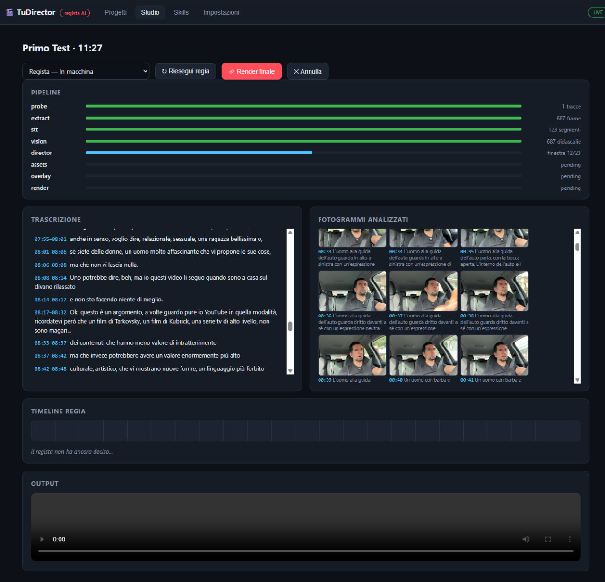
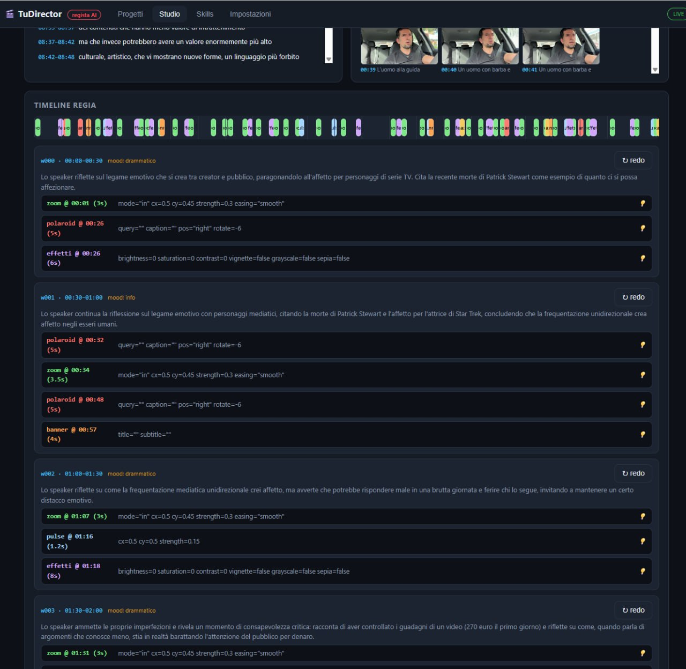
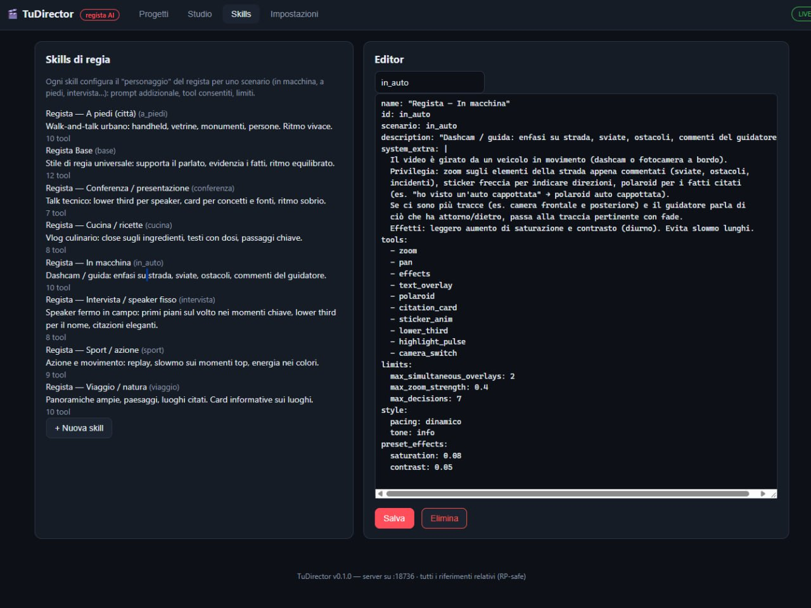
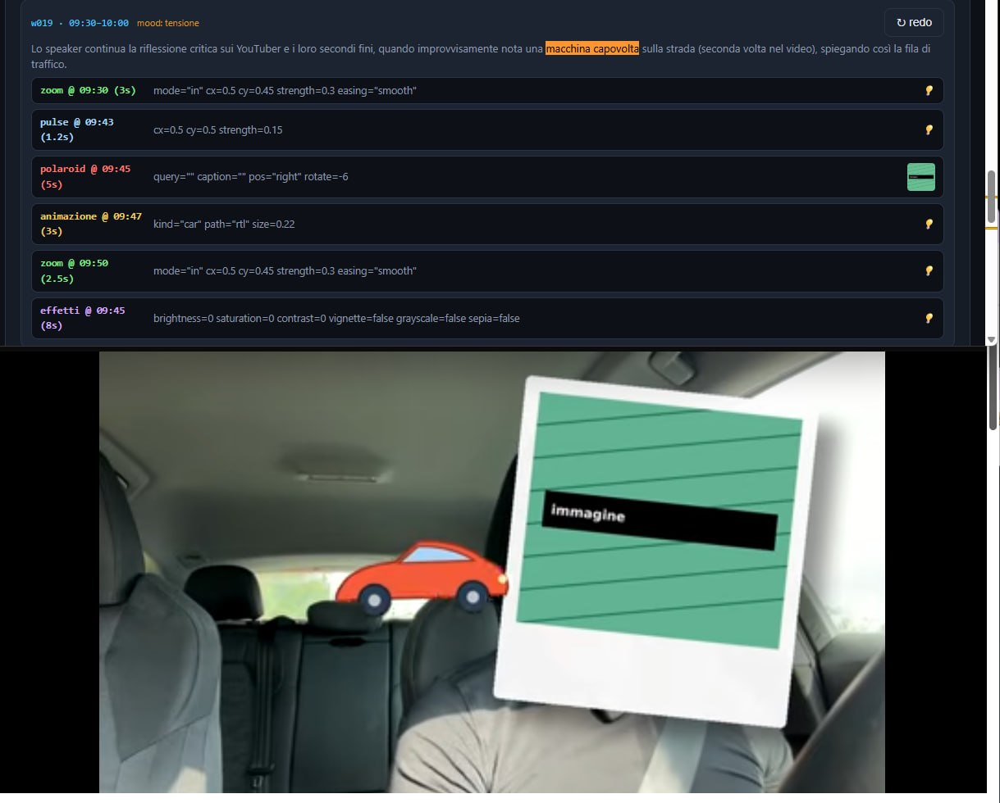
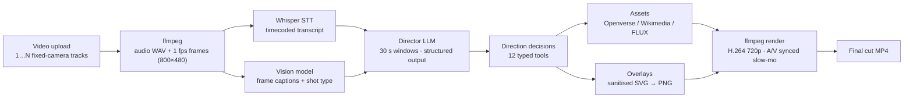

<div align="center">

# 🎬 TuDirector

**An AI film director for your fixed-camera videos.**

Upload one or more videos — TuDirector transcribes the speech, watches every frame,
then a *director LLM* cuts a **first automatic edit**: zooms, captions, polaroids,
citations, camera switches, slow-motion and even a narrated voice-over.
Every decision stays **editable** — review it, tweak it, re-run a single scene, re-render.

[](https://www.python.org/)
[](https://fastapi.tiangolo.com/)
[](https://ffmpeg.org/)
[](LICENSE)
[](#quickstart)

</div>

---

## 📸 Screenshots

> **➡️ TO ADD BEFORE PUBLISHING** — capture the screens below and save them with these
> exact names in `docs/screenshots/` (see [`docs/screenshots/README.md`](docs/screenshots/README.md)
> for the shot list). Then delete this note.

|  |
|:---:|
| **The Studio** — live pipeline, timecoded transcript, analysed frames, director timeline |

|  |  |
|:---:|:---:|
| **Drop a video** (or several multi-camera tracks) and pick a directing style | **Directing styles** — editable YAML skills |

|  |
|:---:|
| **The result** — a still from a rendered cut: lower-third, polaroid of a fact mentioned by the speaker |

---

## 💡 The idea

Cameras today are everywhere — dashcams, phones on a tripod, conference recordings — but
the footage stays *raw*. Real directing means thousands of small decisions: when to zoom
in, when to show a picture of what the speaker is talking about, when to cut to the other
camera. TuDirector automates that **first cut**:

1. You upload **one video** (or **several tracks** from fixed cameras covering the same event).
2. The system transcribes the audio with **timecodes** and describes **every second of video**
   with a vision model.
3. An LLM playing the role of **director** examines the footage in ~30-second windows — with
   the previous window's summary for narrative continuity — and emits **typed direction
   decisions** through a tool registry.
4. Everything is rendered locally with **ffmpeg** into a final MP4.
5. Nothing is carved in stone: open the Studio, read *why* each decision was made,
   **redo any window** with your own note, then re-render. The AI directs the first cut,
   **you** direct the AI.

No API keys? It runs in **mock mode** so you can try the whole pipeline offline.

## ⚙️ How it works



| Stage | What happens | Provider |
|---|---|---|
| Extract | audio (mono 16 kHz) + frames at 1 fps resized to 800×480, near-duplicate frames dropped | ffmpeg |
| STT | segment-level transcription with timecodes, cached by audio hash | fal.ai Whisper |
| Vision | 1–2 sentence *televisual* caption per frame (subject, action, shot, faces, motion), batched 10/request, cached by frame hash | OpenRouter (Gemini Flash by default) |
| Director | per-window decisions with strict JSON schema; fixed 30 s windows or **scene-detection-aligned** windows; previous summary injected for continuity | OpenRouter (Claude Sonnet by default) |
| Assets | images for polaroids & citations: license-filtered Openverse → Wikimedia Commons → FLUX text-to-image fallback; TTS voice-over clips | Openverse / Wikimedia / fal.ai |
| Overlay | director-authored SVG is sanitised (no scripts) then rasterised; polaroids composed with frame, caption, rotation, shadow | cairosvg + Pillow |
| Render | single-pass filter chain per track; multi-camera cuts/fades via `xfade`; **real slow motion** with video `setpts` + audio `atempo` kept in sync, later decisions re-mapped to the new timeline | ffmpeg |

## 🧰 The director's toolbox

The director LLM doesn't write free-form notes — it **calls tools** from a registry, with
server-side validation and clamping:

| Tool | Effect |
|---|---|
| `zoom` · `pan` · `highlight_pulse` | animated crop toward a point, drifting crop, quick attention pulse |
| `effects` | brightness / saturation / contrast / vignette / grayscale / sepia |
| `text_overlay` · `lower_third` | SVG text with fade / slide / typewriter animation; elegant banner |
| `polaroid` | *the speaker mentions a fact → a captioned polaroid of it appears on screen* |
| `citation_card` | *the speaker quotes an author or book → author portrait / book cover card* |
| `sticker_anim` | animated sticker (car, arrow, star) travelling across the screen |
| `camera_switch` | cut or cross-fade to another fixed-camera track |
| `slowmo` | real slow motion, video and audio in sync, timeline re-mapped |
| `narration` | TTS voice-over mixed into the soundtrack |

## 🎭 Directing styles ("Skills")

A skill is a small YAML file that turns the director into a different character per
scenario — which tools it may use, its limits, its pacing:

```yaml
# tuddirector/skills/in_auto.yaml
name: "Regista — In macchina"
description: "Dashcam / driving: road hazards, turns, speaker comments."
system_extra: |
  The video is shot from a moving vehicle. Favour zooms on road elements
  when commented, arrow stickers for turns, subtle effects, polaroids
  for mentioned facts. Avoid long slow-mo.
tools: [zoom, pan, effects, text_overlay, polaroid, sticker_anim, camera_switch, lower_third]
limits: {max_simultaneous_overlays: 2, max_zoom_strength: 0.4}
style: {pacing: "dinamico", tone: "info"}
```

Shipped scenarios: **base, in the car, on foot, interview, travel, kitchen, sport,
conference** — create your own in the Skills editor (validated YAML, hot-reloaded).

## 👀 Human in the loop

- **Studio** view: pipeline progress, timecoded transcript, analysed frame strip.
- Per-window inspector: the input the director saw, its decisions, and the cost of the call.
- **Redo** any single window with an extra note ("less zoom here", "mention the book")
  without re-running the whole job — caches make it cheap.
- Editable models & pipeline parameters (frame rate, window length/mode, concurrency,
  asset policy, output fps) at runtime from Settings.
- Full API call log (provider, model, tokens, latency, estimated cost) for transparency.

## 🚀 Quickstart

```bash
git clone <your-repo-url> && cd TuDirector
python3 -m venv .venv && . .venv/bin/activate
pip install -r requirements.txt
cp .env.example .env        # optional: add your keys
./run.sh                    # → http://localhost:18736
```

Requirements: Python 3.10+, `ffmpeg`/`ffprobe` in PATH.

| Key | Used for | Where to get it |
|---|---|---|
| `TD_OPENROUTER_API_KEY` | vision + director LLM | [openrouter.ai/keys](https://openrouter.ai/keys) |
| `TD_FAL_KEY` | Whisper STT, FLUX images, TTS | [fal.ai/dashboard/keys](https://fal.ai/dashboard/keys) |

Both are optional — without keys the app runs in **mock mode** (demo transcript + stub
decisions), perfect for trying the UI and the render pipeline. All models and pipeline
parameters can also be overridden with `TD_*` env vars — see `.env.example`.

Sits happily behind a reverse proxy: every URL is relative (`api/…`, `media/…`), so any
sub-path works. Unit testing it? `GET /api/health`, `GET /api/pipeline`.

## 🗂 Project layout

```
tuddirector/        FastAPI backend
  main.py           HTTP API + static UI
  pipeline.py       job orchestration (8 stages)
  media.py          ffprobe / frame & audio extraction
  stt.py vision.py  Whisper + vision batching (disk-cached)
  director.py       windowing + director LLM (structured output)
  director_tools.py the 12-tool registry & validation
  assets.py         Openverse / Wikimedia / FLUX resolution
  overlay.py tts.py SVG→PNG, polaroids, stickers · TTS clips
  render.py         ffmpeg timeline render (slow-mo, xfade)
  skills.py + skills/*.yaml   directing styles
  prompts/          editable vision & director prompts
web/                vanilla-JS single-page UI
docs/               technical plan & LLM pipeline details (IT)
data/               jobs, caches, logs (gitignored)
```

## 🗺 Roadmap

- [x] Multi-track analysis & `camera_switch` rendering
- [x] Scene-detection-aligned director windows
- [x] Real slow motion with A/V sync
- [x] TTS narration tool
- [x] Vision/STT content-hash caches
- [ ] Slow motion in the multi-camera path
- [ ] Automatic audio ducking under narrations
- [ ] Caption re-ranking with a second cheap model
- [ ] Fine-tune skills from 👍/👎 feedback on decisions

## 📄 License

[MIT](LICENSE) — © 2026 TuDirector contributors.
